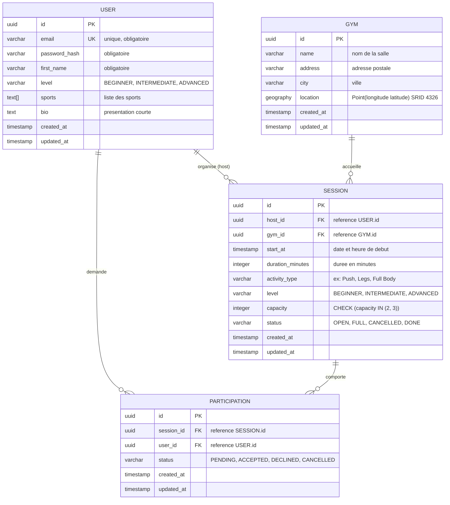

# Conception de GymOn (Backend)

Ce document constitue la source de vérité du périmètre technique et fonctionnel de l'API GymOn.

---

## 1. Résumé du service

GymOn permet à des pratiquants de musculation en salle de publier des séances d'entraînement, de trouver des partenaires à proximité selon leurs disponibilités, et de gérer les demandes de participation.

---

## 2. Périmètre fonctionnel du MVP

### 2.1 Inclus dans le MVP
- **Authentification & Profil** :
  - Inscription, connexion, déconnexion.
  - Consultation et modification du profil (prénom, niveau, sports, bio).
  - Suppression de compte (conformité RGPD).
  - Respect de la vie privée : l'email et le mot de passe ne sont jamais exposés à d'autres utilisateurs.
- **Salles de sport (Gyms)** :
  - Recherche géospatiale des salles à proximité (coordonnées GPS + rayon en km).
  - Consultation de la fiche d'une salle.
  - Suggestion d'une nouvelle salle par un utilisateur.
- **Séances (Sessions)** :
  - Création par un hôte (salle, date/heure, durée, type de séance, niveau requis, capacité).
  - Recherche multicritères (par salle, intervalle de dates, niveau).
  - Consultation du détail d'une séance.
  - Modification et annulation par l'hôte (pas de suppression physique).
- **Participations** :
  - Demande d'un utilisateur pour rejoindre une séance.
  - Consultation des demandes reçues par l'hôte.
  - Acceptation ou refus par l'hôte (avec verrouillage transactionnel pour respecter la capacité).
  - Annulation de sa demande ou de sa participation par le participant.

### 2.2 Exclus du MVP (évolutions futures)
- Messagerie instantanée intégrée.
- Notifications push / email.
- Signalement et blocage d'utilisateurs (le modèle de données actuel permet de l'ajouter sans rupture).
- Avis et notations post-séance.
- Salles favorites et séances récurrentes.

---

## 3. Modèle de données & Choix d'architecture

### 3.1 Arbitrages validés
- **Clés primaires** : `UUID v4` pour toutes les tables (sécurité contre l'énumération).
- **Géolocalisation** : Utilisation de **PostGIS** avec le type `geography(Point, 4326)` sur la table des salles pour des requêtes de distance précises et indexées spatialement.
- **Pratiques sportives** : Tableau natif `TEXT[]` dans PostgreSQL pour la flexibilité du profil.
- **Authentification & Mots de passe** : Jetons JWT (stateless) avec stockage de mot de passe haché par **bcrypt** (selon le standard de l'industrie).
- **Format d'échange API (JSON)** :
  - Succès : `{ "success": true, "data": { ... } }`
  - Erreur : `{ "success": false, "error": { "code": "STRING_CODE", "message": "...", "details": [] } }`

### 3.2 Schéma relationnel (ERD)

### 3.3 Contraintes d'intégrité et règles métier
1. **Capacité** :
   - `capacity` strictement égale à `2` ou `3` personnes au total (hôte inclus).
   - Validée à l'entrée de l'API et sécurisée par une contrainte SQL `CHECK (capacity IN (2, 3))`.
2. **Gestion de la concurrence** :
   - L'acceptation d'une participation s'exécute dans une transaction SQL sérialisable ou avec verrouillage (`FOR UPDATE`) pour éviter tout dépassement de capacité en cas de requêtes simultanées.
   - Une séance passe au statut `FULL` dès que le nombre de participations au statut `ACCEPTED` atteint `capacity - 1`.
3. **Unicité & Interdictions** :
   - Contrainte `UNIQUE (session_id, user_id)` sur la table `PARTICIPATION`.
   - Interdiction applicative (couche service) pour l'hôte de créer une participation sur sa propre séance.
4. **Cycle de vie & Transitions d'état** :
   - Séance : `OPEN` -> `FULL` -> `DONE` ou `CANCELLED`.
   - Participation :
     - `PENDING` -> `ACCEPTED` ou `DECLINED` (action de l'hôte uniquement).
     - `PENDING` ou `ACCEPTED` -> `CANCELLED` (action du participant uniquement).
   - Aucune suppression physique d'une séance active : bascule vers `CANCELLED`.

---

## 4. Spécification des endpoints REST (/api/v1)

| Méthode | Route | Rôle | Accès |
|---|---|---|---|
| `POST` | `/api/v1/auth/signup` | Inscription nouvel utilisateur | Public |
| `POST` | `/api/v1/auth/login` | Connexion et émission de token/session | Public |
| `POST` | `/api/v1/auth/logout` | Déconnexion | Authentifié |
| `GET` | `/api/v1/users/me` | Voir son profil | Authentifié |
| `PATCH` | `/api/v1/users/me` | Mettre à jour son profil | Authentifié |
| `DELETE` | `/api/v1/users/me` | Supprimer son compte (RGPD) | Authentifié |
| `GET` | `/api/v1/gyms?near=lat,lng&radius=km` | Rechercher des salles à proximité | Authentifié |
| `GET` | `/api/v1/gyms/:id` | Détail d'une salle | Authentifié |
| `POST` | `/api/v1/gyms` | Suggérer une salle | Authentifié |
| `POST` | `/api/v1/sessions` | Créer une séance | Authentifié |
| `GET` | `/api/v1/sessions?gymId=&from=&to=&level=` | Rechercher des séances | Authentifié |
| `GET` | `/api/v1/sessions/:id` | Détail d'une séance et participants acceptés | Authentifié |
| `PATCH` | `/api/v1/sessions/:id` | Modifier ou annuler sa séance | Hôte uniquement |
| `GET` | `/api/v1/users/me/sessions` | Lister ses séances créées | Authentifié |
| `POST` | `/api/v1/sessions/:id/participations` | Demander à rejoindre | Non-hôte |
| `GET` | `/api/v1/sessions/:id/participations` | Voir les demandes | Hôte uniquement |
| `PATCH` | `/api/v1/participations/:id` | Accepter/refuser ou annuler sa participation | Hôte / Participant |
| `GET` | `/api/v1/users/me/participations` | Suivre l'état de ses demandes | Authentifié |

---

## 5. Décisions ouvertes restantes à trancher

1. **Public visé** : Limitation explicite aux personnes majeures (18 ans et plus) avec vérification de date de naissance à l'inscription, ou simple case à cocher CGU.
2. **Pagination & Tri** : Curseur vs Offset/Limit pour la liste des séances.
